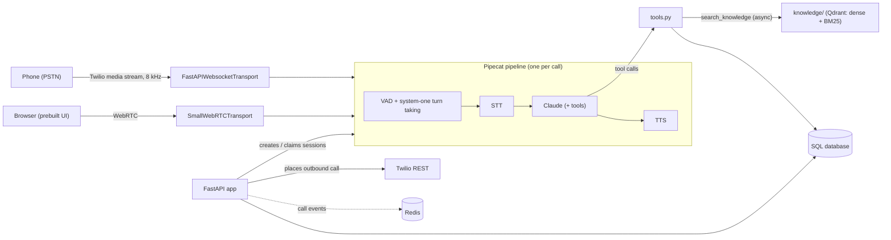

# HR Screener: a voice agent that screens tutor candidates

"Sofia" works for TuTeacher, a fictional private-tutoring agency in Madrid. She phones a tutor
candidate (or talks to them in the browser), checks she has the right person, asks five
screening questions, saves each answer as a typed fact, and books an onboarding session if a
deterministic rule says the candidate qualifies. She answers questions about pay, contracts,
tax and invoicing from a Spanish knowledge base, and hands what she cannot answer to a
recruiter. After the call a stronger model writes a structured summary. A dropped call resumes
as a follow-up that asks only what is missing. Calls run in English or Spanish.

Built with [Pipecat](https://github.com/pipecat-ai/pipecat), Claude (Haiku for the
conversation, Sonnet for the summary), AssemblyAI speech-to-text and text-to-speech, a
Cloudflare Workers AI model for turn-taking, FastAPI, SQLAlchemy, Redis, Qdrant and Twilio.

**Contents:** [How I built it](#how-i-built-it) · [Features](#Features) ·
[Setup](#setup) · [Architecture](#architecture) ·
[Key design decisions](#key-design-decisions) · [Evaluation](#evaluation) ·
[Lessons from test calls](#lessons-from-test-calls) ·
[Potential improvements](#potential-improvements) · [Development](#development)

## How I built it

A voice agent is a stochastic system talking to people who pause, mumble, change their mind and
hang up. Unit tests cannot tell you whether it behaves well, so the work was organised around
measuring behaviour.

**1. Evals drive the decisions.** The big choices were made by running a comparison, not by
ear:

- the turn-taking design was developed on a benchmark, with paired A/B runs and a held-out set
  ([decision 7](#7-turn-taking-a-small-decision-model-reads-the-transcript));
- the conversation model was chosen by running the whole conversation suite on Haiku and
  gpt-4.1-mini side by side ([decision 10](#10-model-choice-haiku-over-gpt-41-mini));
- a Spanish prompt was removed after an A/B over 42 conversations per arm showed it made no
  difference ([decision 9](#9-one-english-prompt-only-spoken-text-is-translated));
- the knowledge base "no match" threshold was tuned on the retrieval eval.

**2. Research before building.** Before writing code I compared how production voice agents are
built: speech-to-speech sounds more natural, but a cascade (STT, LLM, TTS) gives reliable tool
calls, a text transcript to log, test and replay, and one stage at a time to measure. A
screening call must save facts and book correctly, so control won. When turn-taking felt wrong,
I looked for a way to measure it before changing anything, found the academic
[Full-Duplex-Bench](https://github.com/DanielLin94144/Full-Duplex-Bench) and adapted it to stream
its audio through this pipeline over a phone-quality profile. The knowledge base was designed
and its retrieval eval written before the tool was built, and the `knowledge/normativa/`
documents were researched against official Spanish sources, each with an `as_of` date.

**3. Evals get the human attention.** Code, scenarios and golden questions are drafted with AI
help; where I spend most of my own attention as an engineer is validating the evals. I decide
what each scenario must prove, drawing on three sources: every branch of the follow-up state
(what is on file when the next call starts), past bugs, and business harm (booking someone who
does not qualify, double-booking, telling a rejected candidate why). I review every check for
what it can miss, and read failing transcripts before trusting a number. The design follows
from that: the harness (not the simulated candidate) decides when a call drops, pass/fail comes
from hard checks on the database, and a run where the harness could not create the situation is
reported as invalid, never as a pass. The LLM judge only reports; it is not calibrated, so it
never decides a result. The 80 golden questions of the retrieval eval, including
speech-recognition noise, mixed language and out-of-scope questions, were reviewed the same way.

**4. Manual testing finds what evals cannot.** I made real calls throughout, in Spanish and English,
and read the transcripts of eval runs. Ten of the 19 [lessons](#lessons-from-test-calls) were
found on live calls: a hang-up that cut the candidate off, reasoning spoken aloud, a "un momentito"
that left Sofia silent. Manual Spanish calls also found turn-taking failures the English-only
benchmark cannot show, which became the design now in production. Each fix then got an eval
scenario, or a static test when it protects an invariant.

## Features

| Requirement                                   | Where                                                                                                                                                       |
| --------------------------------------------- | ----------------------------------------------------------------------------------------------------------------------------------------------------------- |
| Natural conversation collecting specific data | identity, interest, start date, subjects, levels, weekly availability, teaching format, work authorization, experience ([call flow](#call-flow))            |
| Extraction and validation, structured format  | one `record_*` tool per answer with typed, enum-checked arguments; invalid values come back as structured errors the model recovers from                    |
| Graceful errors and invalid input             | past dates and placeholder answers rejected, booking refused for an ineligible candidate, LLM stall recovery, a safe hang-up                                |
| Conversation context                          | the full context within a call; across calls, a dropped call resumes with its facts loaded ([decision 4](#4-memory-across-calls-and-fail-closed))           |
| Storage as JSON, summary with key points      | SQL tables as the record, `GET /screenings/{id}` as one JSON document; a Sonnet summary with a deterministic fallback ([data](#data-and-structured-output)) |
| Python, LLM, STT and TTS of choice            | Python 3.12, Claude, AssemblyAI; providers swappable by setting                                                                                             |
| RAG                                           | 16 Spanish documents, hybrid search in Qdrant, an async tool, a hand-off to a recruiter ([decision 8](#8-the-knowledge-base-is-an-async-tool))              |
| Frustration detection                         | per-turn frustration judgments, quoted frustration signals in the summary, optional in-call notes to Sofia ([decision 11](#11-frustration-detection))       |
| Multi-turn memory                             | memory across calls ([decision 4](#4-memory-across-calls-and-fail-closed))                                                                                  |
| Multiple languages                            | English and Spanish, switchable mid-call ([decision 9](#9-one-english-prompt-only-spoken-text-is-translated))                                               |

## Setup

Needs Python 3.12, [uv](https://docs.astral.sh/uv/) and Docker (for Redis).

```bash
make install          # uv sync
make redis            # docker compose up -d redis
cp .env.example .env  # then add the keys below
make seed             # migrations, a demo opening, a candidate and 6 onboarding slots
make dev              # http://localhost:7860, auto-reload
```

Keys in `.env`: `ANTHROPIC_API_KEY`, `ASSEMBLYAI_API_KEY`, `CLOUDFLARE_ACCOUNT_ID` and
`CLOUDFLARE_API_TOKEN` (the turn-taking model; Workers AI permission), and `OPENAI_API_KEY` for
the knowledge base embeddings (or `EMBEDDING_PROVIDER=local` to run it keyless). Every setting
is documented in `.env.example`; `LANGUAGE=en|es` sets the language a call starts in.

- **Browser:** open <http://localhost:7860>, click connect and talk. Inspect the call afterwards
  with `curl localhost:7860/screenings/<id>` and `make report`.
- **Terminal:** `make chat` runs the same pipeline over typed text (same prompt, tools,
  follow-ups and finalization; only the LLM key needed). Ctrl-C drops the call, so running it
  again resumes as attempt 2.
- **Phone (Twilio):** run `ngrok http 7860`, set `PUBLIC_BASE_URL` to the exact https URL (no
  trailing slash; webhook signatures are checked against it) and the `TWILIO_*` settings, seed
  with your number (`uv run python -m hr_screener.app.seed --phone +34600000000`), then
  `curl -X POST localhost:7860/screenings -H 'content-type: application/json' -d '{"candidate_id": "<id>", "channel": "phone"}'`.
  A live call lives in the server process, so `make dev`'s `--reload` drops it on any file edit;
  while others edit the checkout, start the server without it:
  `uv run uvicorn hr_screener.app.api:create_app --factory --host 0.0.0.0 --port 7860`.
- **Public demo (Fly.io):** a public home page at `/` (also `/demo`) with a description and an
  application form; the visitor accepts a disclaimer and enters an access code (`DEMO_ACCESS_CODES`)
  to get the call, and afterwards the page shows what the agent recorded. `POST /demo/call` creates
  the candidate and dials it, up to `DEMO_MAX_CALLS_PER_DAY`. The REST API stays behind `DEMO_PASSWORD`.
  `Dockerfile` and `fly.toml` deploy it to Fly.io (one machine, SQLite and the index on a volume).

## Architecture



The FastAPI app owns the screenings and starts one pipeline per call. The pipeline is the same
for the browser, the phone and the terminal; only the transport and sample rate differ (the
text channel has no audio stages). The SQL database (SQLite by default, Postgres by URL) is the
system of record; Redis holds only per-call telemetry, with an expiry.

### Call flow

1. A call is created (`POST /screenings` for the phone, `POST /start` for the browser) and
   claimed with one atomic update, so it can only start once. Sofia speaks first.
2. She confirms identity and interest, then asks the questions one at a time and calls the
   matching `record_*` tool after each answer.
3. The `record_*` call that completes the facts runs the qualification rule and returns the
   verdict in its result: authorized to work, **and** at least one confirmed subject the opening
   needs, **and** able to start within the opening's window.
4. Qualified: `list_onboarding_slots` (at most 3 options), `schedule_onboarding`, `end_call`.
   Not qualified: a polite goodbye with no reasons given.
5. When the call ends the transcript, tool calls and metrics are saved, the summary is written,
   and a call that ended without `end_call` is finalized from its facts.

Tools: `record_start_date`, `record_subjects`, `record_levels`, `record_availability`,
`record_teaching_format`, `record_work_authorization`, `record_experience`,
`list_onboarding_slots`, `schedule_onboarding`, `search_knowledge`, `refer_to_recruiter`,
`switch_language`, `end_call` (all in `src/hr_screener/agent/tools.py`).

### Code layout

| `src/hr_screener/` | Contents                                                                                  |
| ------------------ | ----------------------------------------------------------------------------------------- |
| `app/`             | FastAPI (REST, WebRTC signaling, Twilio webhooks), outbound calls, demo seed              |
| `screening/`       | starting and superseding calls, follow-ups, the qualification rule, the post-call summary |
| `agent/`           | prompt templates, the texts of the tools, the tools and their validation                  |
| `pipeline/`        | the per-call pipeline and finalization, providers, transports, text channel, safe hang-up |
| `llm/`             | LLM services, failure recovery, client-side rate limiter                                  |
| `turn_taking/`     | the system-one turn-taking design (`design.py` holds its parameters)                      |
| `knowledge/`       | RAG: chunking, embeddings, Qdrant store, ingestion                                        |
| `storage/`         | SQL schema and repository                                                                 |
| `observability/`   | event recorder, per-call scorecard ([docs/metrics.md](docs/metrics.md)), `make report`    |
| `i18n/`            | gettext catalogs for what the candidate hears verbatim                                    |

`migrations/` holds the Alembic revisions, `knowledge/` the knowledge base, `evals/` the evals.

### Data and structured output

Tables: openings, candidates, `screenings` (one row per call, with `attempt` and
`previous_screening_id`), `screening_facts`, `transcript_turns`, `tool_calls` (arguments and
results as JSON), `summaries`, `call_metrics`, `referred_questions`, `slots` and `bookings`.
`GET /screenings/{id}` returns a call as one JSON document (shortened, from a real test call):

```json
{
  "screening": {
    "id": "899f7a17160b",
    "status": "completed",
    "outcome": "scheduled",
    "attempt": 1
  },
  "facts": {
    "start_date": "2026-11-17",
    "subjects": ["math", "physics"],
    "levels": ["university"],
    "availability": ["saturday_morning", "workdays_afternoon"],
    "teaching_format": "online",
    "work_authorized": true,
    "experience": "Several years ago tutored two students preparing for the Bachillerato..."
  },
  "qualification": {
    "complete": true,
    "missing": [],
    "qualified": true,
    "reasons": []
  },
  "slot": { "starts_at": "2026-11-13T16:00:00Z", "mode": "online" },
  "transcript": [
    {
      "role": "assistant",
      "text": "Hi there, this is Sofia calling from TuTeacher..."
    },
    "..."
  ],
  "summary": {
    "source": "llm",
    "key_points": [
      "Can start Tuesday, November 17, 2026.",
      "Comfortable teaching only math and physics, not computer science, at university level."
    ],
    "candidate_questions": [],
    "next_step": "Hold the onboarding video call booked for Friday, November 13 at 17:00..."
  }
}
```

The summary model writes only the key points, questions, next step, sentiment and frustration
signals; the code adds the outcome and verdict, so the summary can never contradict the rule. If
the model call fails, a deterministic summary is built from the facts (`source: "fallback"`).

## Key design decisions

### 1. The LLM extracts, Python decides

The model turns speech into typed facts (`authorized: bool`, an ISO date, enum lists).
Eligibility is a plain function of those facts (`screening/qualification.py`): testable,
auditable, and it cannot be talked into a different answer. The booking tools check the rule
again, so a confused model cannot book an ineligible candidate.

### 2. One tool per answer, saved the moment it is given

A tool that took two answers lost the first when a call dropped between them, and made
gpt-4.1-mini invent the second argument (lessons 8 and 19). Each answer now has its own tool and
is saved at once. Tool errors are structured (`invalid_<param>` with the valid values,
`missing_facts` with a hint), and every result names what is still missing, so the model has one
source of truth.

### 3. Bookings and call claims are single SQL statements

A booking is `UPDATE slots SET booked = booked + 1 WHERE booked < capacity` plus an insert keyed
by the screening: it cannot overbook and a retry is idempotent (tested with 10 concurrent
bookers). Status changes are compare-and-set, so a call is claimed once; that also makes the
screening id a one-time token for Twilio's unsigned media stream. Twilio's webhooks are checked
against `X-Twilio-Signature`.

### 4. Memory across calls, and fail closed

When a call dropped or the candidate asked to be called later, the next call links to it, copies
its facts and gets a "Previous call" section in the prompt: Sofia calls back instead of
introducing herself again and asks only what is missing. A candidate who was booked or rejected
is closed and never screened again. If the call history cannot be loaded, the call fails closed:
a fixed apology and a hang-up, rather than risk re-screening someone already decided.

### 5. The hang-up never cuts the candidate off

`end_call` waits until the goodbye has actually left the output transport, then for 3 s of
silence; candidate speech holds the timer and a new turn cancels the hang-up. This came from a
live call where "Gracias…" was read as a goodbye mid-sentence (lesson 1).

### 6. Recovering from model failures

A request with no first chunk after 5 s is sent again. A second failure in a row, or a quota
error, makes Sofia apologize in the call language and end the call; the screening stays
resumable. Before this a stalled stream left Sofia silent for good (lesson 14).

### 7. Turn-taking: a small decision model reads the transcript

Voice activity alone made Sofia take the turn while candidates paused to think, and stop for any
voice: an "mm-hm", a TV, someone else in the room. The production design keeps VAD to open a
turn fast and adds a system-one model (Cloudflare Workers AI) that answers yes/no questions as
the transcript streams: is the turn complete, is the caller asking for time, is this meant for
Sofia, is it a real interruption. Side talk and backchannels never reach the LLM; stop phrases
interrupt at once.

It was developed eval-first on the adapted Full-Duplex-Bench, with a fixed bench agent so runs
measure the design rather than the prompt. The second iteration held on 60 fresh held-out
samples:

| Held-out: baseline (VAD + Smart Turn) → system-one v2 |                             |
| ----------------------------------------------------- | --------------------------- |
| Side talk answered                                    | 90% → 20% (p = 0.016)       |
| Background speech answered                            | 100% → 30% (p = 0.016)      |
| Backchannels talked through                           | 42% → 100%                  |
| Turn-taking: responded / latency                      | 7/10 → 10/10, 3.3 s → 2.2 s |

The costs held too: Sofia stops about 1.5 s later on a real interruption, and text carries no
intonation, so she sometimes takes the turn at a complete-sounding sentence mid-monologue.
Manual Spanish calls then found cases the English-only bench cannot show (a thinking pause cut
short, a "No." dropped as side talk, a "un momentito" that kept her silent), which became v3,
now in production. Its benchmark run is prepared but not run yet. Every run and number:
[evals/turn_taking/reports/SUMMARY.md](evals/turn_taking/reports/SUMMARY.md).

### 8. The knowledge base is an async tool

- **A tool the model calls**, not retrieval on every turn: most turns answer screening
  questions, and retrieving on each would add latency for nothing.
- **Async**, with a fixed holding line ("Déjame comprobarlo"): a slow or failed lookup never
  leaves dead air, and the conversation continues while it runs. The line is fixed because text
  the model writes around a tool call is where its reasoning leaks out loud (lesson 10).
- **Spanish documents only**, split by heading. The LLM translates both ways: it writes the
  query in Spanish and answers in the call language.
- **Hybrid search** (dense vectors plus BM25 with a Spanish stemmer, fused with RRF in Qdrant):
  Spanish administrative terms (RETA, IRPF, _modelo 130_) are where embeddings alone miss.
- **"No match"** is the best dense score below a threshold tuned by the eval, because RRF scores
  are rank-based and cannot say "nothing relevant".
- **What she cannot answer goes to a recruiter** (`refer_to_recruiter`); a question that got
  neither an answer nor a hand-off is saved by the system at the end of the call, so none is
  lost.

### 9. One English prompt; only spoken text is translated

The model always reads English: one prompt, one set of tool schemas. The call language adds a
language rule and configures STT and TTS; only what reaches the candidate verbatim (spoken dates,
apologies, the holding line, the fallback summary) is translated, with gettext. The prompt
carries a calendar (spoken date = ISO date) so the model never does date arithmetic, which is
where small models drifted into English (lesson 5). A candidate can switch language mid-call
(`switch_language`; covered by the text eval, the voice switch not yet tried on a live call). The first design had a full Spanish prompt; an A/B over 42 conversations
per arm found no difference, so it was removed (lesson 11).

The prompt is two Jinja templates that read top to bottom (`agent/templates/screening.j2` and
`closed.j2`, with the shared sections in `_shared.j2`); `agent/prompts.py` only decides which
branch applies and passes plain values. Each template has a fixed part (identity, language,
voice, hard rules, and the knowledge and monitor-note sections when they are on), identical for
every call with the same settings and flags, followed by the part that differs per call
(candidate, opening, previous call, call flow, calendar). The fixed part comes first so that
Anthropic caches it, with the tools, across calls under its own breakpoint
(`ANTHROPIC_FIXED_PROMPT_CACHE_TTL`) and OpenAI's automatic prefix cache hits on it. The rendered
prompts of four representative calls are in [docs/prompts/](docs/prompts/); `make prompts`
regenerates them, so a prompt change is a readable diff in review.

### 10. Model choice: Haiku over gpt-4.1-mini

The conversation eval doubles as a model benchmark: only Sofia's model changes, both arms on the
same code at the same time. After a fix the benchmark itself prompted (lesson 19), pass rates
were level (31/36 Haiku, 31/35 gpt-4.1-mini) and latency comparable. Haiku stays on cost: with
prompt caching its LLM cost per conversation is about a sixth ($0.0021 against $0.0136).
gpt-4.1-mini narrates around tool calls far less (5 of 35 against 18 of 36), which makes Haiku's
narration the next thing to fix. Tables and caveats:
[evals/e2e/README.md](evals/e2e/README.md#haiku-vs-gpt-41-mini).

### 11. Frustration detection

After each candidate turn the turn-taking model is also asked whether the candidate is
frustrated; the judgments are stored per call. The summary records a sentiment and quotes the
candidate's frustrated words; the code drops any quote not found in a candidate turn, so a
recruiter can check the judgment. With `FRUSTRATION_NOTES_ENABLED`, a small rule over recent
judgments sends Sofia a short note so she can adapt. It stays off by
default: six eval calls are too few to turn it on.

### 12. Evals measure behaviour; static tests guard invariants

What Sofia says depends on the model, so it is measured by evals. The ~70 static tests (a few
seconds, no API keys) cover only what an eval would pass while broken: the qualification rule,
booking under concurrency, never re-screening a decided candidate, superseding a live call, the
hang-up never cutting off a speaking candidate, LLM failure recovery, the summary fallback,
migrations matching the models, translation catalogs in sync, webhook signatures, and no lost
knowledge-base question.

## Evaluation

Every suite calls real APIs and spends money, so none is part of `make check`. Overview:
[evals/README.md](evals/README.md).

| Suite                   | What it measures                                                                                                                                                                                                                                                                   | Details                                                                                                        |
| ----------------------- | ---------------------------------------------------------------------------------------------------------------------------------------------------------------------------------------------------------------------------------------------------------------------------------- | -------------------------------------------------------------------------------------------------------------- |
| `make eval-e2e`         | 26 scenarios of whole multi-call screenings through the real pipeline over text: drops at every stage, call-backs, changed answers, closed candidates, knowledge-base questions (slow and down KB), language switch, frustration. Simulated candidate, hard checks on the database | [evals/e2e/README.md](evals/e2e/README.md)                                                                     |
| `make eval-kb`          | retrieval on 80 golden questions. Hybrid recall@4 1.00 with Spanish queries, 1.00 with raw questions; BM25 alone 0.62                                                                                                                                                              | [evals/README.md](evals/README.md)                                                                             |
| `make eval-turn-taking` | Full-Duplex-Bench streamed through the voice pipeline (audio, VAD, STT, TTS in the loop), paired A/B and held-out runs                                                                                                                                                             | [evals/turn_taking/README.md](evals/turn_taking/README.md), [SUMMARY.md](evals/turn_taking/reports/SUMMARY.md) |

In the model benchmark Haiku passed 55 of 56 valid screening conversations. The knowledge-base
scenarios fail often on both models (Haiku 9 of 31); that part is open.

## Lessons from test calls

Problems found on live calls or by the evals, and what changed. Code comments refer to these
numbers.

| #   | Problem                                                                                                     | Fix                                                                                              | Found by         |
| --- | ----------------------------------------------------------------------------------------------------------- | ------------------------------------------------------------------------------------------------ | ---------------- |
| 1   | The call ended while the candidate was still talking ("Gracias…")                                           | hang-up waits for the goodbye to play plus a grace window; speech cancels it                     | live call        |
| 2   | Sofia spoke her reasoning aloud, in English, in a Spanish call                                              | prompt rule: everything written is spoken; fix mistakes silently                                 | live call        |
| 3   | A placeholder ("Schedule not yet asked") saved as an answer                                                 | tools reject placeholders                                                                        | live call        |
| 4   | Noise or echo interrupted Sofia                                                                             | a voice alone no longer interrupts; the turn-taking model must judge it (not re-tested for echo) | live call        |
| 5   | Switch to English right after a date tool call                                                              | a dated calendar in the prompt and a spoken date in the tool result                              | live call        |
| 6   | A question right after the goodbye was lost                                                                 | 3 s grace held while the candidate speaks                                                        | live call        |
| 7   | Reconnecting quickly started a fresh call with no context                                                   | a new call supersedes the live one, then resumes it                                              | live call        |
| 8   | A follow-up re-asked an answer already given                                                                | one tool per answer                                                                              | live call, eval  |
| 9   | Follow-ups re-asked saved facts (7 of 84 conversations)                                                     | the follow-up prompt lists only the missing questions                                            | eval             |
| 10  | Sofia sometimes narrates around tool calls                                                                  | open: a model habit the language check cannot see                                                | eval transcripts |
| 11  | Two prompt catalogs to keep in sync                                                                         | A/B showed no effect; one English prompt                                                         | eval             |
| 12  | A start date in the wrong year was saved and the candidate booked                                           | past dates rejected with a hint                                                                  | eval             |
| 13  | A follow-up asked again whether the candidate was still interested                                          | interest is asked once per screening                                                             | live call, eval  |
| 14  | A stalled LLM stream left Sofia silent for the rest of the call                                             | stall re-send and recovery; silence fails the eval                                               | eval             |
| 15  | "Un momentito" kept Sofia silent until the caller hung up                                                   | a request for time ends the turn; she checks in after 10 s and 20 s                              | live call        |
| 16  | Every knowledge-base eval scenario was invalid                                                              | the harness read the holding line as a final apology; it is now its own frame type               | eval             |
| 17  | Sofia asked the same question twice in one reply                                                            | record first, then speak; no forced second reply after a save; a check catches it                | eval             |
| 18  | A start-date correction made while choosing a slot was never saved, and an unqualified candidate was booked | confirm the start date before offering slots; slot tools refuse until it is recorded             | eval             |
| 19  | gpt-4.1-mini saved teaching levels the candidate never gave                                                 | `record_subjects` and `record_levels` split                                                      | model benchmark  |

Two harness lessons came with these: a run where the simulated candidate drifted into the wrong
language must be invalid, and the "invalid" bucket may only hold what the harness caused;
anything the candidate would experience is a product failure.

## Potential improvements

**Product**

- Hand over to a person when a candidate stays frustrated, and turn the frustration notes on once
  more eval runs and live calls back them.
- Answer referred questions after the call (WhatsApp or email, with consent and human review of
  doubtful answers). Today they are saved for a recruiter.
- AI and recording disclosure, voicemail detection, automatic redial.
- Authentication and rate limiting on the REST API.

**Platform: customization and multi-tenancy**

- Agent customization: today the role, the questions, the fact schema, the qualification rule,
  the knowledge base and the voice are code for one agency. Make them a per-agent definition
  (questions and typed facts, a declarative rule, tools, knowledge base, languages, voice) that
  the prompt, the tools and the summary are built from.
- Multi-tenant: several tenants, each with its own kinds of agents (screening, scheduling,
  support). A `tenant_id` on every table and query, a knowledge-base collection per tenant,
  per-tenant keys, quotas and data retention, and no context or cached data shared across
  tenants.
- An eval suite per agent definition, run as the gate before a tenant's configuration change
  goes live, so customization does not mean untested behaviour.

**Scale and operations**

- The live-call registry, the rate limiter and embedded Qdrant are per process; several instances
  need a Redis signal or lease column, a shared limiter and a Qdrant server.
- Events to OpenTelemetry and a metrics stack instead of Redis with a TTL.
- A re-screening policy (re-apply after N months, an audited override); today a decided
  candidate is never screened again.

**Evaluation**

- An audio mode for the conversation suite: the simulated candidate's lines synthesized in both
  languages and played into the voice pipeline with scripted timing (pauses, side talk, answers
  over Sofia), as the gate for turn-taking changes. Today the e2e suite is text only and the
  turn-taking bench is English only.
- Calibrate the judge: hand-label about 20 conversations, measure agreement per question, then try
  Haiku as the judge.
- More runs per scenario: telling 5% from 0% takes about 100 conversations per arm.
- A security eval based on [Aegis](https://arxiv.org/html/2602.07379v1) (Li et al., 2026), a
  red-teaming framework for voice agents: an attacker agent with personas runs multi-turn calls
  against the agent, and attack success is measured per threat category. Mapped to Sofia:
  authentication bypass (screening someone who is not the candidate), privacy leakage (rejection
  reasons, another candidate's data, the prompt), resource abuse (holding several slots, endless
  calls), privilege escalation (talking her into booking an unqualified candidate or reopening a
  closed one) and data poisoning (planting false facts or instructions in the saved facts, the
  summary or a referred question a recruiter will read). It fits the existing harness: attacker
  personas for the simulated candidate, and hard checks on the database rather than a judge,
  since the rule and the booking guards already live in code.
- Build the knowledge-base golden set from real call transcripts and score answers, not only
  retrieval. The `normativa/` documents were not reviewed by a tax adviser.
- Every edge case found in manual test calls should become an eval scenario, or an invariant
  test when an eval would stay green while it is broken. For lack of time, the ones found so
  far were fixed without that coverage.
- A deterministic callback outcome on hang-up: a candidate who asks to be called later and hangs
  up before `end_call` ends as FAILED and is followed up as a dropped call. Inferring
  `callback_requested` needs the summary (or a cheaper classifier) before the status is final,
  without breaking the supersede ordering in `_finalize`.

## Development

```bash
make check       # lint, typecheck and tests
make test        # pytest (no API keys; fakeredis)
make fmt         # ruff format + autofix
make migrate     # apply the Alembic migrations
make ingest      # sync knowledge/ into Qdrant
make eval-e2e    # conversation evals, e.g. SCENARIOS=c,l2 LANGS=es,en RUNS=3
make eval-kb     # retrieval eval (PROVIDER=local runs keyless)
make prompts     # re-render docs/prompts/ after changing a prompt template (no API calls)
make eval-turn-taking CONFIG=evals/turn_taking/configs/baseline.yaml
```

Tooling: [ruff](https://docs.astral.sh/ruff/), [ty](https://docs.astral.sh/ty/) (warnings count
as errors), pytest. The compiled `.mo` catalogs are checked in, and a test fails when one is
stale.
